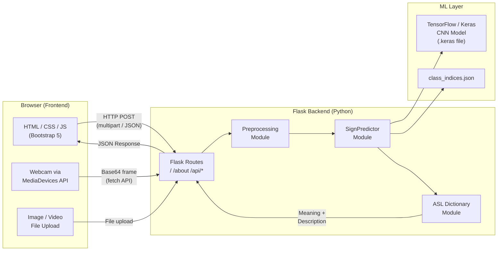
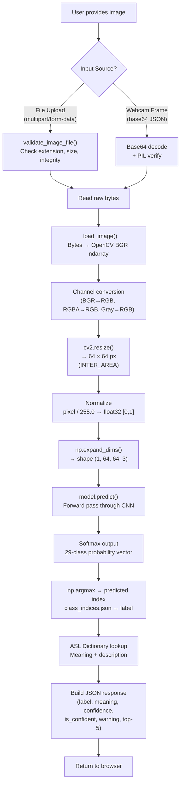
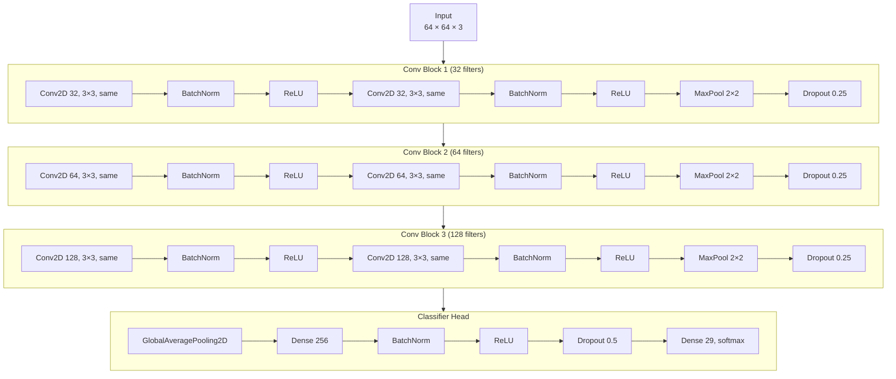
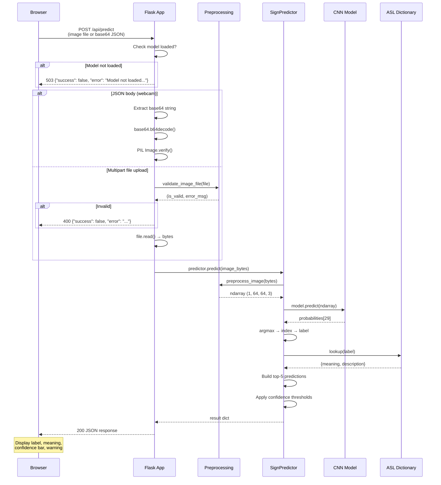

# SignBridge — System Architecture

> **SignBridge** is an AI-powered American Sign Language (ASL) fingerspelling-to-English translator.  
> This document describes the system architecture, data pipeline, CNN model design, and API request flow.

---

## 1. High-Level System Architecture

The application follows a classic **three-tier** pattern: a browser-based frontend communicates with a Flask backend, which delegates inference to a TensorFlow/Keras CNN model.



### Key Components

| Component | Technology | Responsibility |
|---|---|---|
| **Frontend** | HTML5, Bootstrap 5, Vanilla JS | UI, webcam capture, image upload, text composition, speech synthesis |
| **Flask App** (`app.py`) | Flask 3.x | HTTP routing, request validation, JSON responses, error handling |
| **Preprocessing** (`src/preprocessing.py`) | OpenCV, Pillow, NumPy | Image loading, resizing (64×64), normalization ([0,1]), channel conversion |
| **Predictor** (`src/predictor.py`) | TensorFlow/Keras | Model loading, inference, top-5 predictions, confidence thresholding |
| **Dictionary** (`src/dictionary.py`) | Pure Python | Label→English mapping, dynamic-sign detection, character composition |
| **Config** (`config.py`) | Pure Python | Centralized constants (paths, hyperparams, thresholds) |
| **Training** (`train_model.py`) | TF/Keras, scikit-learn | Dataset loading, augmentation, CNN training, model checkpointing |
| **Evaluation** (`evaluate_model.py`) | scikit-learn, seaborn | Confusion matrix, per-class accuracy, classification report |

---

## 2. Data Pipeline

This diagram traces the journey of a single image from the user's browser to a predicted English label.



### Pipeline Notes

- **Consistency**: The same `preprocess_image()` function is used for both uploaded files and webcam frames, ensuring the model always receives identically preprocessed inputs.
- **Normalization**: Pixel values are divided by 255 to produce `float32` values in `[0, 1]`, matching the normalization applied during training.
- **Interpolation**: `cv2.INTER_AREA` is used for downscaling, which is generally preferred for shrinking images as it produces less moiré artifacts.

---

## 3. CNN Model Architecture

The model is a lightweight custom CNN with **three convolutional blocks** followed by a global-average-pooling classifier. It is designed to train on a CPU in a reasonable timeframe.



### Layer-by-Layer Summary

| Stage | Layers | Output Shape | Notes |
|---|---|---|---|
| **Input** | — | 64 × 64 × 3 | RGB image normalized to [0,1] |
| **Block 1** | 2 × (Conv2D 32 + BN + ReLU), MaxPool, Dropout(0.25) | 32 × 32 × 32 | Low-level features (edges, textures) |
| **Block 2** | 2 × (Conv2D 64 + BN + ReLU), MaxPool, Dropout(0.25) | 16 × 16 × 64 | Mid-level features (finger shapes) |
| **Block 3** | 2 × (Conv2D 128 + BN + ReLU), MaxPool, Dropout(0.25) | 8 × 8 × 128 | High-level features (hand poses) |
| **GAP** | GlobalAveragePooling2D | 128 | Spatial dimensions collapsed; reduces params |
| **FC** | Dense(256) + BN + ReLU + Dropout(0.5) | 256 | Non-linear classifier |
| **Output** | Dense(29, softmax) | 29 | One probability per ASL class |

### Training Configuration

| Hyperparameter | Value |
|---|---|
| Optimizer | Adam (lr = 0.001) |
| Loss | Sparse Categorical Crossentropy |
| Metrics | Accuracy |
| Batch Size | 32 |
| Epochs | 15 (with EarlyStopping, patience=5) |
| LR Scheduler | ReduceLROnPlateau (factor=0.5, patience=3) |
| Data Augmentation | RandomFlip, RandomRotation(0.1), RandomZoom(0.1), RandomBrightness(0.1) |
| Checkpointing | Save best model by val_accuracy |

---

## 4. Request-Response Flow — `/api/predict`



### Response Schema

```json
{
  "success": true,
  "label": "A",
  "meaning": "The letter A",
  "description": "Closed fist with thumb resting on the side.",
  "confidence": 0.9823,
  "is_confident": true,
  "is_dynamic": false,
  "dynamic_note": null,
  "warning": null,
  "all_predictions": [
    {"label": "A", "confidence": 0.9823, "meaning": "The letter A"},
    {"label": "S", "confidence": 0.0102, "meaning": "The letter S"}
  ],
  "error": null
}
```

### Confidence Thresholds

| Confidence Range | Behavior |
|---|---|
| ≥ 0.70 | Prediction shown normally |
| 0.50 – 0.70 | Prediction shown with "moderate confidence" warning |
| < 0.50 | `is_confident` = false; "low confidence" warning displayed |

---

## 5. Directory Structure

```
SignBridge/
├── app.py                  # Flask application entry point
├── config.py               # Centralized configuration
├── train_model.py          # Model training script
├── evaluate_model.py       # Post-training evaluation
├── requirements.txt        # Python dependencies
│
├── src/
│   ├── __init__.py
│   ├── predictor.py        # SignPredictor class
│   ├── preprocessing.py    # Image preprocessing & validation
│   └── dictionary.py       # ASL label → English dictionary
│
├── static/
│   ├── css/style.css       # Custom styles (Bootstrap 5 theme)
│   └── js/app.js           # Frontend logic (upload, webcam, video, TTS)
│
├── templates/
│   ├── index.html          # Main application page
│   └── about.html          # About / documentation page
│
├── tests/
│   ├── __init__.py
│   ├── test_app.py         # Flask route & API tests
│   ├── test_dictionary.py  # Dictionary module tests
│   └── test_preprocessing.py # Preprocessing tests
│
├── dataset/                # (User-provided) ASL Alphabet dataset
├── models/                 # Saved model & class_indices.json
├── results/                # Training history, plots, metrics
└── docs/                   # Project documentation
```

---

## 6. Technology Stack Summary

| Layer | Technology | Version |
|---|---|---|
| Language | Python | 3.12+ |
| ML Framework | TensorFlow / Keras | ≥ 2.15 |
| Computer Vision | OpenCV (headless) | ≥ 4.8 |
| Image Processing | Pillow | ≥ 10.0 |
| Numerical Computing | NumPy | ≥ 1.24 |
| Data Splitting | scikit-learn | ≥ 1.3 |
| Visualization | Matplotlib, Seaborn | ≥ 3.7, ≥ 0.12 |
| Web Framework | Flask | ≥ 3.0 |
| Frontend | Bootstrap 5, Vanilla JS | 5.x |
| Testing | pytest | ≥ 7.4 |
| Dataset Source | Kaggle (kagglehub) | ≥ 0.2 |
